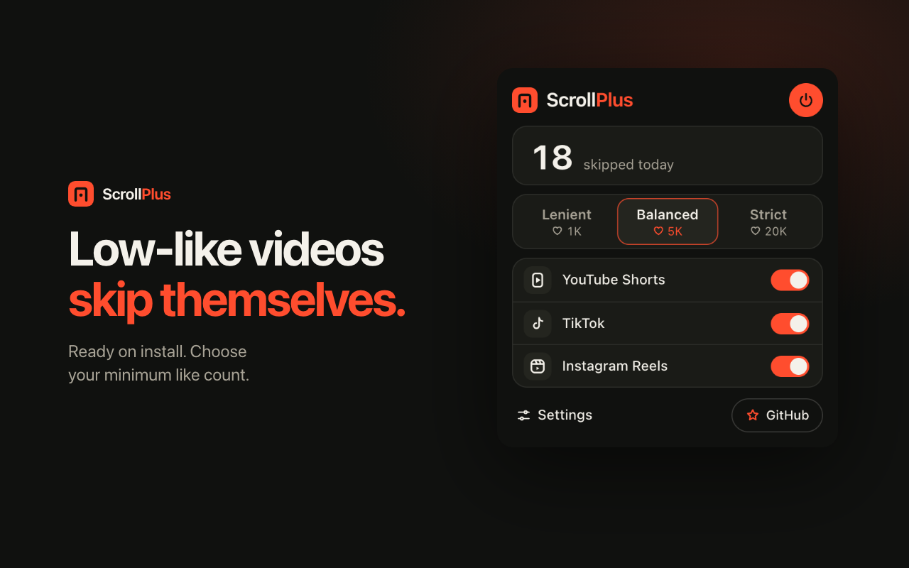
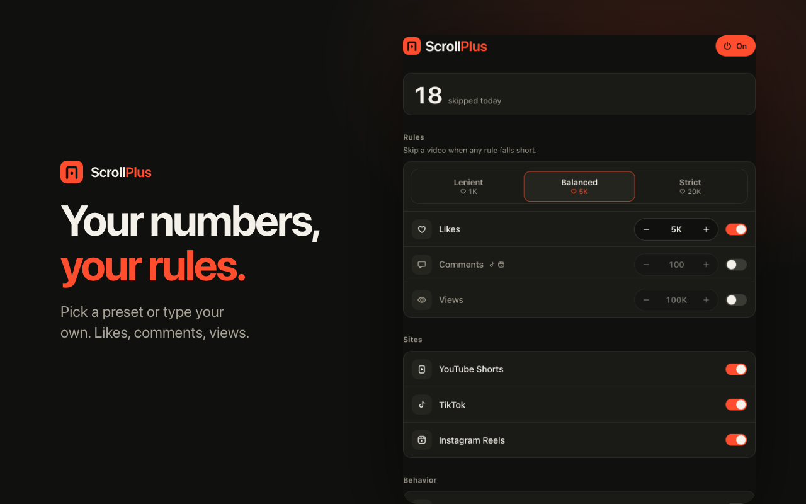
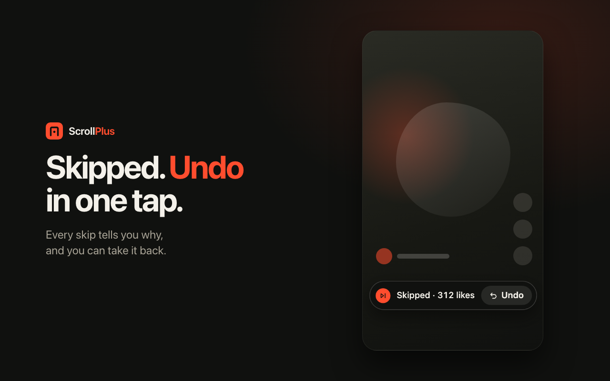

<p align="center"></p>

<h1 align="center">ScrollPlus</h1>

<p align="center"><b>Skip low-like short videos.</b><br>
A Chrome extension that skips YouTube Shorts, TikToks, and Instagram Reels with too few likes.<br>
Installed means on. No account, no setup.</p>

<p align="center"></p>

<p align="center"> </p>

## What it does

Scroll like you always do. When a video has fewer likes than your minimum, ScrollPlus moves to the next one and tells you why. The Undo button appears for a few seconds; a video you restore stays for the browser session, including reloads and new tabs.

The default is simple: **skip anything under 500 likes**. Pick a different level in the popup, or set your own numbers in Settings.

| Preset | Skips videos under |
| --- | --- |
| Lenient | 100 likes |
| Balanced (default) | 500 likes |
| Strict | 1,000 likes |

In Settings you can also turn on a minimum for comments or views, switch a site off, and keep creators you like. Numbers can be typed the way you say them: `500`, `5k`, `2만`, `1,000`.

**Skip ads** is a switch in the popup, on by default. ScrollPlus moves past an ad as soon as the site marks it as one, whatever its like count, with the same reason chip ("Skipped · ad") and Undo. Turn the switch off and ads stay. It only moves past the ad that fills the player. It does not block ad requests or hide anything in lists.

**Keep accounts I follow** is on in Settings. A video from a channel you subscribe to, or an account you follow, stays even under the like bar. ScrollPlus reads that from the page. It does not keep a list. If the page does not say, the video is judged by its likes. An ad is still skipped when Skip ads is on.

**Time saved.** The popup shows a clock and a time value under today's count. Settings also shows the total number of skips and the same time value, with the date counting began. The figure is calculated on your device: each skip counts as about 3 seconds you would have spent on the video before swiping it away yourself, minus the time it stayed on screen. The formula is documented here rather than explained in the interface. The figures are counted from the day you installed or updated to 0.5.0.

**The skip chip** tells you why a video was skipped and has Undo. It stays in the video's left gutter and follows the video when a comments panel opens or closes. Consecutive skips list the last three reasons, newest first. In a narrow gutter it shows only the count and Undo. If there is no safe space on the left, it stays hidden until space returns. On Reels it waits for scrolling to settle before appearing, so moving captions do not make it repeatedly shrink or blink. You can turn the notice off in Settings.

A skip is the site's own Next control, pressed for you, so you see the usual slide to the next video. On YouTube Shorts a skipped video is on screen for about half a second, and it is muted meanwhile. That half second is YouTube's own pace between moves ([timing](qa/skip-timing.md)). On TikTok a skipped video is on screen for about 0.4 s, with its sound on: TikTok takes a mute made by a script as your own choice, so ScrollPlus leaves it alone ([timing](qa/skip-timing-tiktok.md)). On Instagram Reels it is about 0.3 s, measured signed in with the built scripts run in the page ([timing](qa/skip-timing-instagram.md)).

Hidden tabs do not auto-skip. Returning to a feed checks it immediately; the six-skip safety pause remains until you choose to continue.

If a count is missing, the video stays. Photo posts stay too. It never skips on a guess, never hides a feed, and stops after six skips in a row so you can decide to keep going or lower the bar.

Supported: YouTube Shorts, TikTok, and Instagram Reels on the web, in English and Korean.

## Status

ScrollPlus is a public beta, installed from a GitHub release for now (see below).

The next launch steps and remaining live checks are in [ROADMAP.md](ROADMAP.md). 0.7.3 was submitted for first Store review with automatic publication off on 2026-10-14. It is pending review; see the [submission checkpoint](store/draft-readiness.md). Store publication and the product domain remain separate decisions.

The [0.7.4 update candidate](store/update-074.md) includes the subsequent Reels notice, followed-account and wide ad-disclosure fixes. Its package, upgrade checks and version-specific reviewer steps are prepared separately from the first submission. It is not submitted or published, and will need its own Store review. See [candidate QA](qa/release-readiness-074.md).

- Tested on controlled pages for all three sites, including Chrome 120, the oldest supported version.
- Tried on real feeds: YouTube Shorts (a 24-hour automated run on 0.3.5, with two page-reload recoveries), TikTok For You, and Instagram Reels in a signed-in browser. Instagram Reels is the newest and least exercised site.
- Known issue: on YouTube Shorts the feed can occasionally stop responding to scroll and Next while the video keeps playing; reloading the page fixes it. In long automated runs this was YouTube's own request for more Shorts failing with a server error, and it also happens without ScrollPlus ([details](qa/soak.md#youtube-shorts-feed-stalls-youtubes-feed-request-fails)).
- Skip pacing: measured on live YouTube Shorts, on signed-out TikTok For You and on signed-in Instagram Reels ([YouTube](qa/skip-timing.md), [TikTok](qa/skip-timing-tiktok.md), [Instagram](qa/skip-timing-instagram.md)). The median skipped video stays on screen for 0.31 s on TikTok (0.58 s on 0.4.1) and the median skipped reel for 0.32 s on Instagram (0.62 s on 0.4.2). The Instagram figures come from the built scripts run in the page behind a stand-in for chrome.storage, not from an installed extension.
- Skip ads (on by default since 0.5.0): checked on real YouTube Shorts ads with 0.4.x (65 of 65 first-time ads skipped with it on, none with it off), and a live Shorts ad was skipped by the 0.5.0 build. TikTok live ads remain unverified. The corrected 0.7.4 candidate also recognises visible Instagram disclosures: a live eight-like ad stays with ads off, skips with ads on, and Undo restores it ([native correction](qa/reels-ad-disclosure-20261014.md)). Earlier version-specific ad results remain in [ads QA](qa/ads.md).
- Time saved is an estimate that rests on one assumption, 3 seconds for each video you would have swiped away yourself. It is not measured on you.
- Keep accounts I follow covers YouTube, TikTok and Instagram. 0.5.3 also recognises the longer subscribe and follow labels, and stops rereading YouTube responses that did not change. It was checked on controlled pages: a subscribed Short, a followed Reel, and a followed TikTok stay under the like bar. A focused signed-in pass observed YouTube subscribed keep/exception-off skip in the submitted 0.7.3 build and Instagram followed keep/exception-off skip in the post-submission candidate. TikTok live positive behaviour remains open. See [latest follow and motion QA](qa/reels-follow-motion-20261014.md) and [historical follow QA](qa/follow.md).
- Not yet established: ordinary day-long use, TikTok live followed/ad positives and Store-installed update delivery. The native Instagram ad result covers one desktop disclosure layout.

The [0.7.3 first-review candidate](qa/release-readiness-073.md) contains the quiet left-gutter notice. The 0.7.2 state and performance checks are in [foreground hardening](qa/foreground-hardening-072.md). Earlier live claims retain their version scope in [release readiness](qa/release-readiness.md). More: [signed-in QA](qa/signed-in-smoke.md), [long feed QA](qa/soak.md), [UI audit](qa/ui-audit.md), [session Undo QA](qa/session-undo.md).

## Install

It is not on the Chrome Web Store yet. The quickest way to try the current beta is the zip on the [GitHub beta releases page](https://github.com/jeongjin0/scrollplus/releases): unzip it, open `chrome://extensions`, turn on Developer mode, and choose Load unpacked.

To update a beta, replace the contents of the unpacked folder you already loaded with the new ZIP's files, then click Reload on the ScrollPlus card in `chrome://extensions`. Keep only one copy enabled. Extension reloads clear temporary Undo choices. Updating from 0.4.x moves your settings once: each preset keeps its name (Balanced is 500 likes now, it was 5,000), a rule of your own stays as it is, and Skip ads turns on.

To build it yourself:

```bash
git clone https://github.com/jeongjin0/scrollplus.git
cd scrollplus
npm install
npm run build
```

Open `chrome://extensions`, turn on Developer mode, choose Load unpacked, and select `.output/chrome-mv3`. Chrome 120 or newer.

## Develop

```bash
npm test           # rule and number tests
npm run build
npx playwright install chromium
npm run test:e2e   # engine, built adapters, popup, settings, and storage
npm run compile    # type check
npm run dev        # live reload
npm run assets     # re-render the store images
node scripts/capture-ui.mjs  # capture English and Korean UI
```

The product rules are in [SPEC.md](SPEC.md). QA notes are in [qa/](qa). Contributions are welcome, see [CONTRIBUTING.md](CONTRIBUTING.md).

## Privacy

ScrollPlus reads the counts and available ad/follow signals the page has already loaded and decides on your device. Page data is cached in memory while the document remains open. Settings, today's skip count and the all-time total stay in local Chrome storage; Undo choices stay in session memory. None of this is sent to the developer or a third party. See [PRIVACY.md](PRIVACY.md) for storage, retention and removal.

ScrollPlus is not affiliated with YouTube, TikTok, Instagram, or GitHub. The GitHub mark in the popup and on the settings page only links to this repository.

## License

[MIT](LICENSE). If it saves you some scrolling, a ⭐ on this repo helps other people find it. The GitHub mark is GitHub's own, from [Octicons](https://github.com/primer/octicons) (MIT); see [public/THIRD_PARTY_NOTICES.txt](public/THIRD_PARTY_NOTICES.txt).
